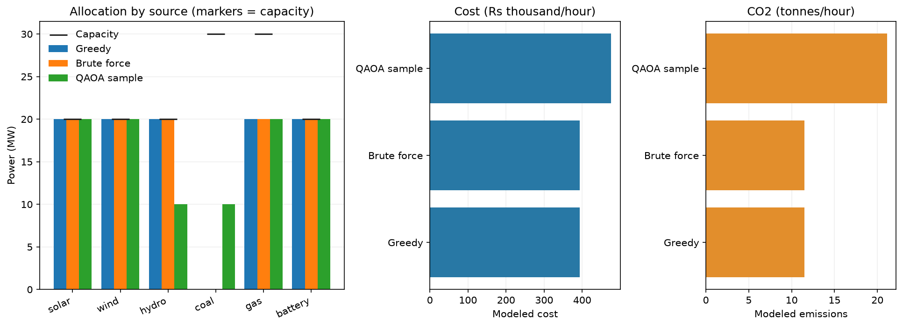

# Energy allocation CLI demo

A small hybrid-style demonstration built on `src/energy_data.py` and `src/qubo_builder.py`. The source model derives weather-adjusted capacities and per-block costs from illustrative site, transport, generation, carbon, and resource assumptions. A pedagogical QAOA statevector simulation is included alongside classical baselines; it runs on a classical computer and does not demonstrate quantum advantage.

## Setup and run

The project pins Python 3.12 in `mise.toml`. With mise installed:

```bash
mise install
mise exec -- python -m venv .venv
.venv/bin/python -m pip install -r requirements.txt
.venv/bin/python main.py --scenario base --plot results/figures/base.png
.venv/bin/python main.py --scenario renewable_shortfall --plot results/figures/renewable_shortfall.png
.venv/bin/python main.py --scenario high_demand --plot results/figures/high_demand.png
```

All methods read the same rows from `data/energy_scenarios.csv`. Each plot compares per-source allocation versus capacity and total cost/CO2 for Greedy, brute force, and the QAOA sample. Choose another CSV with `--data path.csv`, or override the case demand with `--demand MW`.



CSV columns are `scenario,demand_mw,mw_per_block,source,capacity_mw,cost_per_block,co2_t_per_block`. Every row with the same scenario name is one shared optimization input. Capacities and demand must be multiples of the block size. The `base` case reflects the illustrative model values; the other cases vary available capacity/demand to compare behavior across inputs.

## Method and assumptions

Each binary switch represents one dispatch block. Greedy selects the cheapest blocks; brute force enumerates all fixed-cardinality selections; QAOA builds and samples a QUBO from that same source table. If no measured QAOA sample meets demand exactly, a seeded classical bit-flip repair produces a feasible candidate; the plot/report labels it as a QAOA sample, and diagnostics say whether repair was used. Because the objective is linear and separable, greedy and brute force are expected to agree; brute force is retained as an exact check. The QAOA solver is a classical statevector simulation—not quantum hardware or evidence of quantum speedup. Cost/emissions values in the CSV are illustrative; exact enumeration is capped at 24 switches and statevector simulation scales exponentially.
